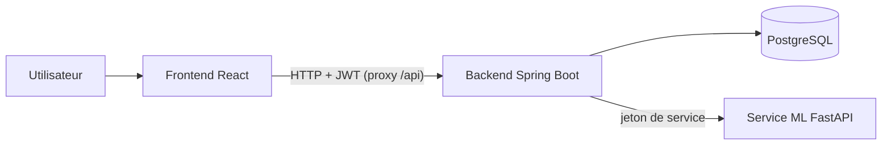

# ChurnGuard

[](https://github.com/ELKHALIFA-AYMEN/churnguard/actions/workflows/ci.yml)
[](https://github.com/ELKHALIFA-AYMEN/churnguard/actions/workflows/frontend.yml)

Plateforme SaaS multi-organisations qui **prédit quels clients risquent de partir** (churn), **explique pourquoi** et aide à prioriser les actions de rétention.

Projet personnel de bout en bout : API Java sécurisée, service de machine learning, interface React, base PostgreSQL, conteneurs et intégration continue.


## Ce que fait ChurnGuard

1. Une organisation s'inscrit et obtient un administrateur.
2. Elle **importe ses clients** depuis un fichier CSV (validation stricte, rapport ligne par ligne, réimport sans doublons).
3. Elle **lance le calcul** : chaque client reçoit une probabilité de départ et ses raisons.
4. Le **tableau de bord** liste les clients à risque, du plus au moins risqué, avec la raison principale.
5. La **fiche d'un client** détaille ce qui augmente le risque et ce qui rassure.
6. Un administrateur peut **exporter** ou **supprimer** les données d'un client (droits d'accès et d'effacement).

Trois rôles : `ADMIN` (tout), `ANALYST` (importe et calcule), `VIEWER` (consulte).

## Architecture



| Dossier | Rôle | Technologies |
|---|---|---|
| `backend/` | API REST, authentification, règles métier, import | Java 21, Spring Boot, Spring Security, JPA, Flyway |
| `ml-service/` | Entraînement et prédiction | Python 3.12, FastAPI, scikit-learn |
| `frontend/` | Interface | React, TypeScript, Vite |
| `docker-compose.yml` | Base de données et service ML | PostgreSQL 16, Docker |
| `.github/` | Intégration continue et mises à jour des dépendances | GitHub Actions, Dependabot |

Le schéma de données et les décisions de conception sont détaillés dans [`docs/architecture.md`](docs/architecture.md).

## Le modèle de prédiction

- **Données** : jeu public *Telco Customer Churn* (7 043 clients, 26,5 % de départs). Les prédictions servent à illustrer la plateforme, ce ne sont pas de vraies décisions commerciales.
- **Modèle** : régression logistique. Comparée à d'autres modèles en validation croisée, elle s'est montrée statistiquement équivalente, et elle reste simple à expliquer.
- **Explications** : la contribution de chaque variable au score est regroupée en 5 thèmes (par exemple le contrat ou l'ancienneté), pour ne pas compter deux fois des variables corrélées.
- **Seuil de décision : 0,20.** Il est volontairement bas : mieux vaut contacter quelques clients de trop que rater un départ.

| Mesure (jeu de test, 1 409 clients) | Valeur |
|---|---|
| AUC | 0,841 |
| AUC-PR | 0,634 |
| Rappel au seuil 0,20 | 85 % |
| Précision au seuil 0,20 | 46,8 % |

Lecture : le modèle détecte 85 % des clients qui partent, et environ un client signalé sur deux part réellement. Les notebooks d'exploration et de modélisation sont dans `ml-service/notebooks/`.

## Sécurité

Chaque mesure est vérifiée par un test automatique ou par un contrôle documenté.

| Mesure | Détail |
|---|---|
| Authentification | JWT signé (HS256), expiration 60 minutes, sans session serveur ; mots de passe hachés avec BCrypt |
| Autorisation | Rôles appliqués côté serveur à chaque route ; l'interface masque les boutons interdits mais n'est jamais la protection |
| Isolation des organisations | L'organisation est lue dans le jeton, jamais dans la requête ; une donnée d'une autre organisation répond 404, comme une donnée inexistante |
| Force brute | 10 requêtes par minute et par adresse IP sur `/api/auth/`, réponse 429 avec `Retry-After` |
| Messages d'erreur | Identiques pour un e-mail inconnu et un mauvais mot de passe ; aucune valeur de données dans les erreurs ni les journaux |
| En-têtes HTTP | `nosniff`, `X-Frame-Options: DENY`, `Cache-Control: no-store`, `Content-Security-Policy`, `Referrer-Policy` |
| Entrées non fiables | Validation des DTO, import CSV strict (colonnes, types, bornes, taille) |
| Service ML | Accessible seulement avec un jeton de service (comparaison en temps constant), lié à `127.0.0.1`, conteneur en lecture seule, sans capacités Linux |
| Données sensibles | Genre, senior, partenaire et personnes à charge ne sont ni stockés, ni envoyés au modèle |
| Secrets | Uniquement dans `.env` (ignoré par Git) ; un secret trop court est refusé au démarrage |
| Dépendances | Surveillance hebdomadaire par Dependabot (Maven, pip, npm, Docker, GitHub Actions) |

Un audit a été réalisé en fin de projet : il a révélé l'absence de protection contre la force brute et de deux en-têtes HTTP, corrigés et couverts par des tests.

## Protection des données personnelles

- **Minimisation** : seules les variables utiles au modèle sont conservées.
- **Droit d'accès** : `GET /api/customers/{id}/export` renvoie toutes les données d'un client et sa prédiction (administrateur uniquement).
- **Droit à l'effacement** : `DELETE /api/customers/{id}` supprime le client et sa prédiction (la base applique la suppression en cascade). La suppression est tracée par identifiant technique, sans donnée personnelle.
- **Décision humaine** : le modèle recommande, une personne décide d'appeler ou non le client.

Ce sont des mesures techniques qui facilitent la conformité au RGPD ; elles ne constituent pas une certification.

## Qualité

**98 tests automatisés**, exécutés à chaque `push` par GitHub Actions :

| Partie | Tests | Outils |
|---|---|---|
| Back-end | 65 | JUnit, MockMvc, Testcontainers (PostgreSQL jetable) |
| Service ML | 17 | pytest |
| Front-end | 16 | Vitest, Testing Library |

## Lancer le projet

Prérequis : Docker Desktop, Java 21, Git, VS Code avec l'extension *Dev Containers*. Python et Node s'exécutent dans le Dev Container fourni (`.devcontainer/`), ce qui garantit le même environnement pour tout le monde.

**1. Créer le fichier de configuration.** Copier `.env.example` en `.env`, puis remplacer chaque `change_me...` par une valeur aléatoire longue. Exemple de génération (PowerShell) :

```powershell
$b = New-Object byte[] 48; [Security.Cryptography.RandomNumberGenerator]::Create().GetBytes($b); [Convert]::ToBase64String($b)
```

**2. Entraîner le modèle.** Télécharger le jeu *Telco Customer Churn* (Kaggle) dans `data/raw/` (dossier ignoré par Git). Dans le Dev Container :

```bash
cd ml-service
python -m app.training ../data/raw/<nom-du-fichier>.csv
```

Le modèle est écrit dans `ml-service/models/` (ignoré par Git) et ses métriques dans `metrics.json`.

**3. Démarrer la base et le service ML :**

```bash
docker compose up -d
```

**4. Démarrer le back-end** (les variables du fichier `.env` doivent être visibles du processus, par exemple dans la configuration de lancement de l'IDE) :

```bash
cd backend
./mvnw spring-boot:run
```

**5. Démarrer le front-end** (dans le Dev Container) :

```bash
cd frontend
npm ci
npm run dev
```

**6. Créer l'organisation.** L'interface n'a pas de page d'inscription : la création passe par l'API (le mot de passe doit faire au moins 12 caractères).

```bash
curl -X POST http://localhost:8080/api/auth/register \
  -H "Content-Type: application/json" \
  -d '{"organizationName":"Mon organisation","email":"admin@example.com","password":"un-mot-de-passe-long"}'
```

Sous PowerShell, utiliser `curl.exe` et échapper les guillemets :

```powershell
curl.exe -X POST http://localhost:8080/api/auth/register -H "Content-Type: application/json" -d "{\"organizationName\":\"Mon organisation\",\"email\":\"admin@example.com\",\"password\":\"un-mot-de-passe-long\"}"
```

**7. Se connecter et essayer.** Ouvrir http://localhost:5173, se connecter avec cet e-mail, puis :

1. page **Données** : importer le fichier CSV, puis lancer le calcul ;
2. page **Tableau de bord** : parcourir les clients à risque et ouvrir une fiche.

## Lancer les tests

```bash
cd backend && ./mvnw verify       # Docker doit être démarré (Testcontainers)
cd ml-service && pytest           # dans le Dev Container
cd frontend && npm run test       # dans le Dev Container
```

## Choix et limites assumés

- **Format d'import figé** sur les colonnes du jeu Telco. Évolutions naturelles : un écran de correspondance des colonnes et un modèle entraîné par organisation.
- **Limiteur de requêtes en mémoire** : suffisant pour une instance unique ; avec plusieurs instances, il faudrait un stockage partagé (Redis). Derrière un proxy, l'adresse IP réelle devra être configurée explicitement.
- **Jeton conservé dans `sessionStorage`** : choix simple, exposé en cas de faille XSS ; un cookie `HttpOnly` serait plus robuste (compromis documenté dans le code).
- **Pas encore déployé** : le projet tourne en local avec Docker Compose. HTTPS et en-tête HSTS sont à prévoir au déploiement.
- **Jeu de données public** : les performances reflètent ce jeu, pas un cas réel.