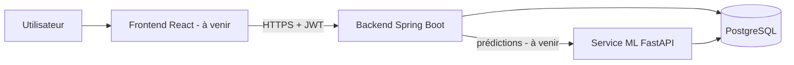
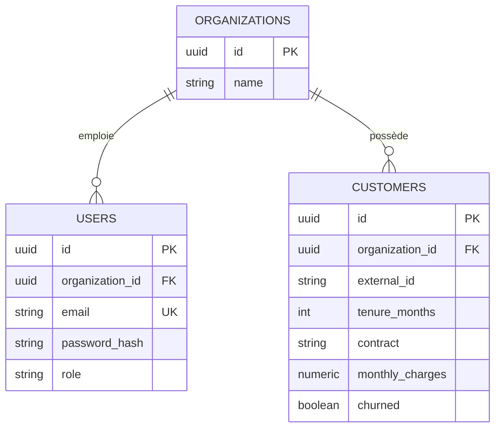

# Architecture de ChurnGuard

## Vue d'ensemble

| Composant | Rôle | Statut |
|---|---|---|
| Backend Spring Boot | API REST, authentification, import, règles métier | Fait |
| PostgreSQL | Stockage des organisations, utilisateurs, clients | Fait |
| Service ML (FastAPI) | Entraînement et prédiction du churn | À venir |
| Frontend React | Tableau de bord | À venir |

## Modèle de données

Un client est unique par couple (organisation, identifiant externe).

## Sécurité

- **Authentification** : jeton JWT signé (HS256), expiration de 60 minutes, sans session côté serveur.
- **Mots de passe** : hachés avec BCrypt, jamais renvoyés ni journalisés.
- **Autorisation** : rôles `ADMIN`, `ANALYST`, `VIEWER`, appliqués par méthode.
- **Isolation multi-tenant** : l'organisation est lue dans le jeton, jamais dans la requête. Un client d'une autre organisation répond 404, comme un client inexistant.
- **Entrées non fiables** : validation des DTO, import CSV strict (colonnes obligatoires, valeurs contrôlées, taille limitée), messages d'erreur sans valeurs de données.
- **Secrets** : variables d'environnement (`.env` ignoré par Git).

## Décisions de conception

| Décision | Raison |
|---|---|
| Genre et statut senior non stockés | Minimisation des données (RGPD) et risque de biais discriminatoire dans le modèle |
| Import partiel avec rapport | Une ligne invalide ne doit pas bloquer 7 000 lignes valides |
| Réimport par mise à jour | Un fichier corrigé peut être réimporté sans doublons |
| Migrations Flyway | Historique de la base versionné avec le code |
| Tests sur PostgreSQL jetable (Testcontainers) | Tests fidèles à la production |

## Limites connues

- Le format d'import est figé (colonnes du jeu Telco) pour le MVP. Une évolution naturelle est un écran de correspondance de colonnes et un modèle entraîné par organisation.