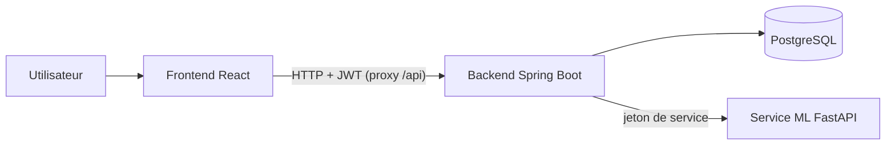
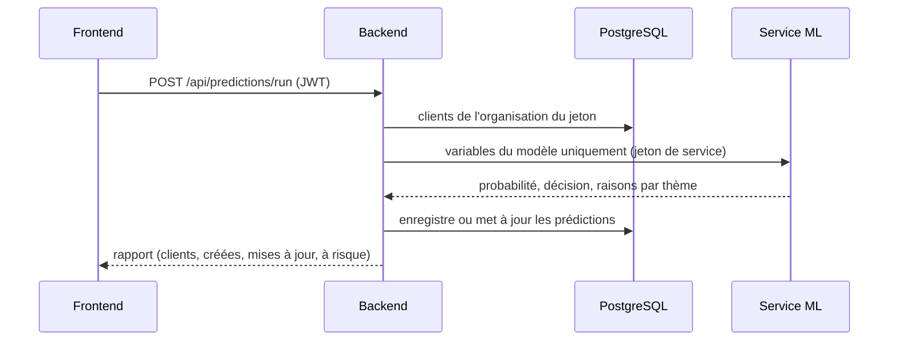
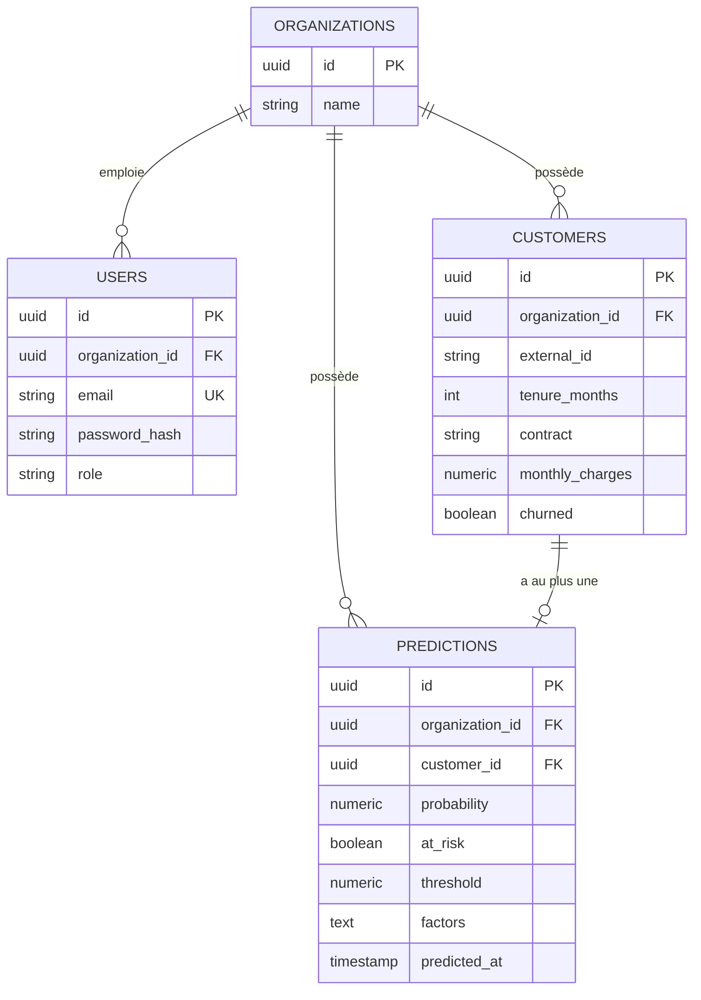

# Architecture de ChurnGuard

## Vue d'ensemble

| Composant | Rôle |
|---|---|
| Frontend React | Connexion, import, tableau de bord, fiche client, export et suppression |
| Backend Spring Boot | API REST, authentification, autorisation, import, orchestration du calcul |
| PostgreSQL | Organisations, utilisateurs, clients, prédictions (schéma versionné avec Flyway) |
| Service ML (FastAPI) | Calcule la probabilité de départ et les raisons ; ne touche jamais la base |

Le service ML est séparé du back-end : il est écrit dans le langage de l'écosystème machine learning, peut être mis à jour indépendamment, et n'a accès à aucune donnée autre que celles qu'on lui envoie.

## Parcours : lancer le calcul

Si le service ML est indisponible, le back-end répond 503 et n'enregistre rien.

## Modèle de données

- Un client est unique par couple (organisation, identifiant externe).
- Un client a **au plus une** prédiction : relancer le calcul la met à jour au lieu d'en créer une nouvelle.
- La suppression d'un client entraîne celle de sa prédiction (`ON DELETE CASCADE`).
- Les autres colonnes de `CUSTOMERS` décrivent les services souscrits et la facturation.

## Sécurité

Le détail des mesures et de leurs preuves figure dans le [README](../README.md#sécurité). Les principes d'architecture :

- **L'organisation vient du jeton**, jamais de la requête : un client d'une autre organisation répond 404, comme un client inexistant.
- **Défense en profondeur** : limitation des requêtes sur `/api/auth/`, en-têtes HTTP de protection, validation stricte des entrées, messages d'erreur sans données.
- **Le service ML n'est pas exposé** : lié à `127.0.0.1`, il exige un jeton de service et tourne dans un conteneur durci.
- **Contrôle d'accès côté serveur** : l'interface masque les actions interdites par confort, mais ne protège rien.

## Décisions de conception

| Décision | Raison |
|---|---|
| Genre, senior, partenaire et personnes à charge non stockés | Minimisation des données (RGPD) et risque de biais discriminatoire dans le modèle |
| Régression logistique | Statistiquement équivalente aux autres modèles testés en validation croisée, et explicable |
| Seuil de décision à 0,20 | Privilégie le rappel (85 % des départs détectés) au prix de la précision |
| Explications regroupées en 5 thèmes | Évite de compter deux fois des variables corrélées ; une ligne lisible pour un conseiller |
| Prédictions enregistrées en base | La liste et la fiche ne rappellent pas le service ML à chaque affichage |
| Import partiel avec rapport | Une ligne invalide ne doit pas bloquer 7 000 lignes valides |
| Réimport par mise à jour | Un fichier corrigé peut être réimporté sans doublons |
| Migrations Flyway | Historique de la base versionné avec le code |
| Tests sur PostgreSQL jetable (Testcontainers) | Tests fidèles à la production |
| Proxy `/api` côté Vite | Le navigateur ne parle qu'à une origine, sans configuration CORS ouverte |

## Limites connues

- Le format d'import est figé (colonnes du jeu Telco). Évolution naturelle : un écran de correspondance de colonnes et un modèle entraîné par organisation.
- Le limiteur de requêtes est en mémoire : une seule instance du back-end. Plusieurs instances demanderaient un stockage partagé.
- Le jeton de connexion est conservé dans `sessionStorage` : un cookie `HttpOnly` serait plus robuste face aux failles XSS.
- L'export ne contient pas la date d'import du client.
- Pas encore de déploiement : HTTPS et HSTS sont à prévoir.